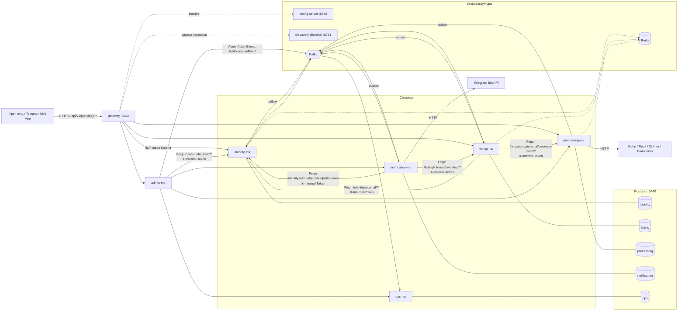
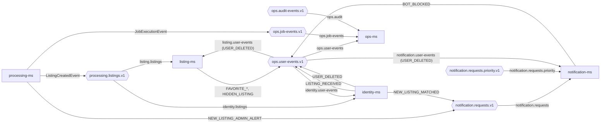
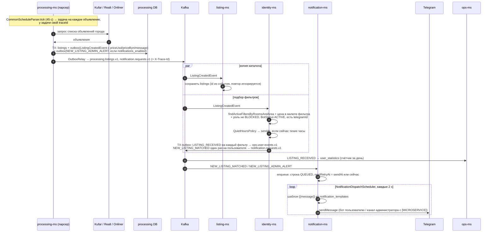
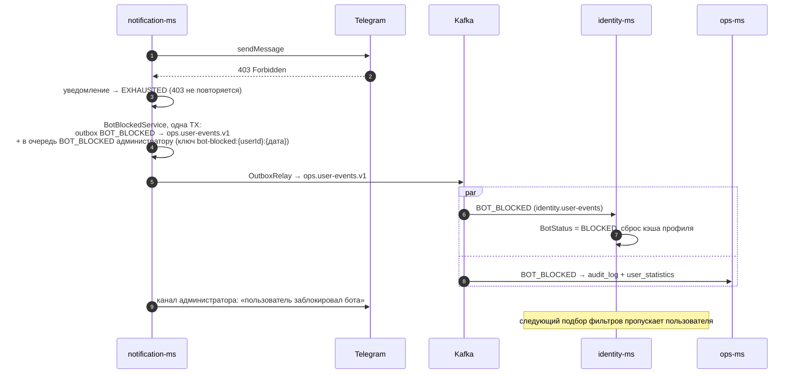
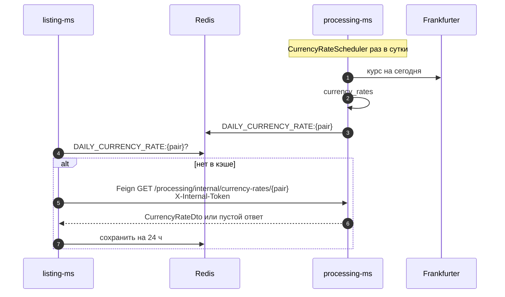
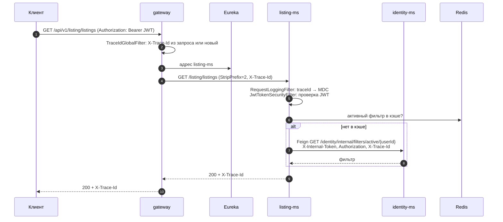
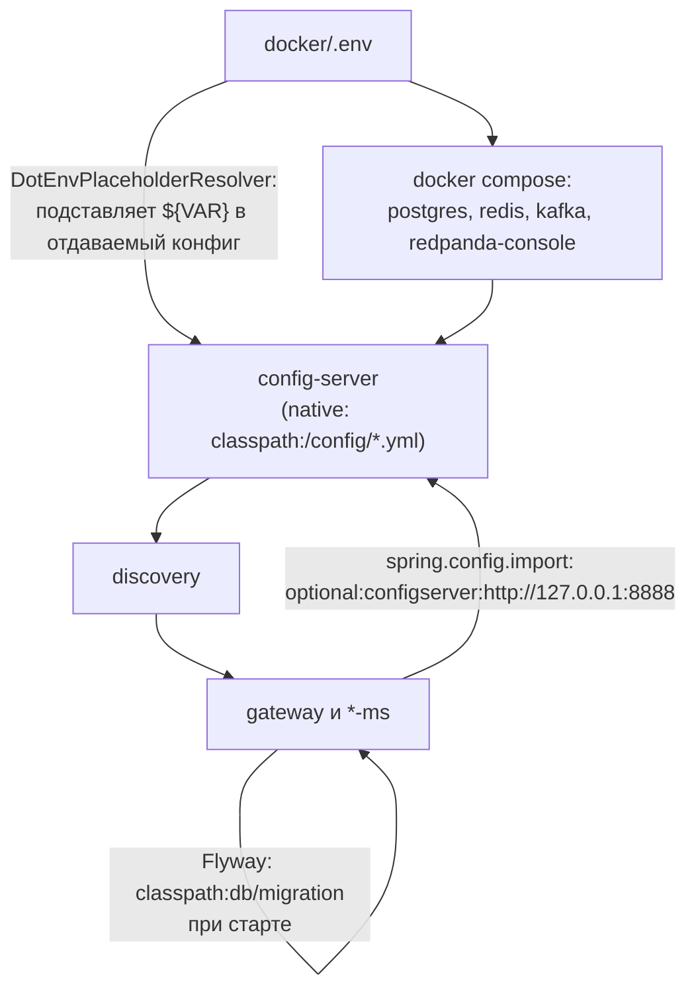
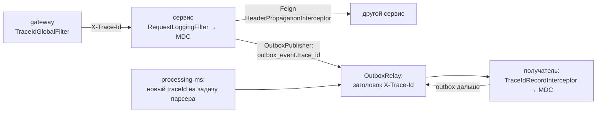

# Взаимодействие сервисов (текущая реализация)

Состояние на 2026-09-30

## Сервисы

| Сервис          | Порт | База (Postgres :5440) | Отвечает за                                                                                                   | REST (через gateway)    |
|-----------------|------|-----------------------|---------------------------------------------------------------------------------------------------------------|-------------------------|
| gateway         | 8222 | —                     | единая точка входа, маршрутизация, `X-Trace-Id`                                                               | —                       |
| config-server   | 8888 | —                     | конфиги всех сервисов (`native`), подстановка значений из `docker/.env`                                       | —                       |
| discovery       | 8761 | —                     | Eureka, реестр сервисов                                                                                       | —                       |
| identity-ms     | 8081 | `identity`            | вход через Telegram, JWT, профили, фильтры, обратная связь, подбор фильтров к новым объявлениям, статус бота  | `/api/v1/identity/**`   |
| notification-ms | 8082 | `notification`        | очередь и доставка уведомлений (Telegram-бот, Telegram администратору, email, WebSocket — заготовка), шаблоны, каналы пользователя, напоминания о просмотрах | `/api/v1/notification/**` |
| ops-ms          | 8083 | `ops`                 | журнал аудита, история задач, статистика пользователей                                                        | нет контроллеров        |
| listing-ms      | 8084 | `listing`             | каталог объявлений (копия), избранное, скрытые, календарь просмотров, пересчёт цен по курсам из processing-ms | `/api/v1/listing/**`    |
| processing-ms   | 8085 | `processing`          | парсеры Kufar, Realt, Onliner, курсы валют (Frankfurter) и внутренний API курсов, города и настройки парсеров | `/api/v1/processing/**` |
| admin-ms        | 8086 | —                     | админ-API поверх сервисов-владельцев: вход, профили, города, настройки парсеров, отзывы, журнал аудита, задачи, статистика, рассылки; действия пишет в `ops.audit-events.v1` | `/api/v1/admin/**`      |

Инфраструктура (`docker/docker-compose.yml`):

| Компонент                                                | Порт на хосте |
|----------------------------------------------------------|---------------|
| Postgres, отдельная база и пользователь на каждый сервис | 5440          |
| Redis                                                    | 6400          |
| Kafka (внутри сети `kafka:29092`)                        | 9092          |
| Redpanda Console                                         | 9999          |

Общие библиотеки (`libs/`):

| Библиотека             | Что в ней                                                                                |
|------------------------|------------------------------------------------------------------------------------------|
| `dto`                  | контракты событий и запросов, `KafkaTopics`, `GlobalConstants`                           |
| `common-util`          | JWT, исключения, шифрование, логирование запросов и `traceId`                            |
| `kafka-util`           | outbox, конфигурация producer и consumer, DLT, `traceId` в заголовках                    |
| `redis-util`           | кэш, блокировки, сессии                                                                  |
| `internal-integration` | Feign-клиенты к identity-ms, listing-ms и processing-ms с кэшем в Redis, повторами и circuit breaker |

## Общая схема

## Kafka: топики, отправители и получатели

## Сценарий: новое объявление → уведомления

## Сценарий: пользователь заблокировал бота

## Сценарий: пересчёт цены в listing-ms

Ключ `DAILY_CURRENCY_RATE:{pair}` в Redis общий для обоих сервисов: processing-ms обновляет его после загрузки курсов, поэтому listing-ms видит новый курс без вызова.

## Сценарий: запрос пользователя через gateway

## Конфигурация и запуск

Порядок запуска:

1. `docker compose up -d` в папке `docker/`.
2. config-server.
3. discovery.
4. Сервисы и gateway в любом порядке.

## Сквозной traceId

- **Где виден `traceId`.** В логах он стоит в квадратных скобках после имени потока (`%X{traceId}`). По нему находится вся цепочка от парсера до отправки уведомления.
- **Что пишется в лог:**

  | Запрос | Кто пишет | Что | Уровень |
    |---|---|---|---|
  | Входящий | `LoggingInterceptor` | метод, путь, статус, время | INFO (без `/actuator`) |
  | Входящий | `RequestResponseLoggingFilter` | тела запроса и ответа | только при `LOG_LEVEL_APP=DEBUG` |
  | Исходящий к внешним API | `OutgoingRequestLoggingInterceptor` | хост и путь без query, токен бота замаскирован | INFO |
  | Feign | уровень `BASIC` | метод, URL, статус, время | DEBUG для `com.rentalert.internal.client` |

- **Где `traceId` теряется:** уведомления, которые диспетчер отправляет из очереди (тихие часы, повторы), не связаны с исходным запросом.
